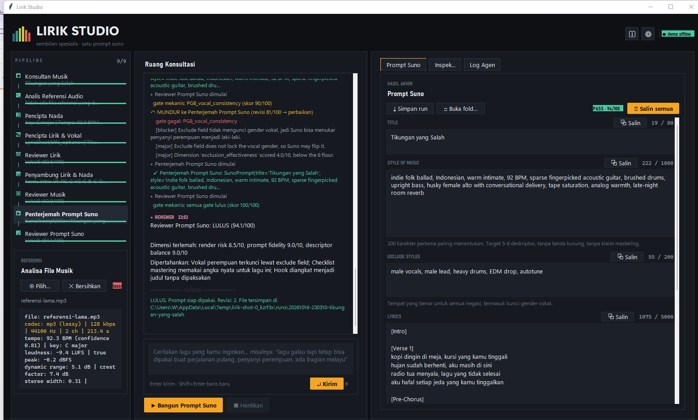
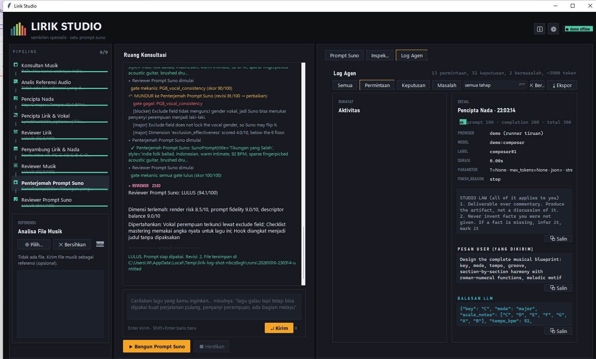

# Lirik Studio

**Sembilan agen spesialis yang bekerja seperti satu studio** — dari obrolan bahasa
awam sampai satu prompt Suno yang siap ditempel, lengkap dengan checklist master
lossless.

[](https://www.python.org/)
[](#arsitektur)
[](#menjalankan-tes)
[](LICENSE)
[](#prasyarat)



Tidak butuh framework, tidak butuh akun cloud. Cukup satu endpoint
OpenAI-compatible: OpenAI, OpenRouter, Groq, DeepSeek, Ollama, LM Studio, vLLM,
llama.cpp server, atau apa pun yang bicara `/v1`.

---

## Daftar isi

- [Kenapa sembilan agen](#kenapa-sembilan-agen)
- [Tangkapan layar](#tangkapan-layar)
- [Unduh dan jalankan](#unduh-dan-jalankan)
- [Prasyarat](#prasyarat)
- [Cara pakai](#cara-pakai)
- [Syarat lulus review](#syarat-lulus-review)
- [Loop review dan rollback](#loop-review-dan-rollback)
- [Routing per agen](#routing-per-agen)
- [Tab Log Agen](#tab-log-agen)
- [Analisa file referensi](#analisa-file-referensi)
- [Max token](#max-token)
- [Arsitektur](#arsitektur)
- [Membangun .exe sendiri](#membangun-exe-sendiri)
- [Menjalankan tes](#menjalankan-tes)
- [Catatan teknis](#catatan-teknis)
- [Keterbatasan yang jujur](#keterbatasan-yang-jujur)
- [Kontribusi dan lisensi](#kontribusi-dan-lisensi)

---

## Kenapa sembilan agen

Satu prompt besar yang "melakukan semuanya" cenderung mengorbankan justru hal yang
paling dibutuhkan: disiplin teknis pada batas karakter Suno dan kualitas lirik yang
layak dinyanyikan. Karena itu pekerjaannya dipecah, dan tiap bagian punya penilai
yang bisa menolaknya.

| # | Agen | Spesialisasi | Keluaran |
|---|---|---|---|
| 1 | Konsultan Musik | bahasa awam → spesifikasi; tak pernah minta istilah teknis | `CreativeBrief` |
| 2 | Analis Referensi Audio | mp3/wav/m4a/flac: tempo, key, LUFS, cutoff, transcode | `ReferenceProfile` |
| 3 | Pencipta Nada | tonalitas, progresi fungsional, groove, motif, kurva tegangan | `MusicBlueprint` |
| 4 | Pencipta Lirik & Vokal | lirik + gender/tipe suara/register/delivery, arah instrumental | `LyricSheet` |
| 5 | Reviewer Lirik | orisinalitas, citraan, kelayakan nyanyi, klise, kesesuaian vokal | `ReviewVerdict` |
| 6 | Penyambung Lirik & Nada | grid bar/beat, suku kata per beat, tabrakan aksen, napas, hook | `Arrangement` |
| 7 | Reviewer Musik | struktur, harmoni, kontur melodi, karakter, kelayakan produksi | `ReviewVerdict` |
| 8 | Penterjemah Prompt Suno | judul, style, exclude, lirik bertag, checklist lossless | `SunoPrompt` |
| 9 | Reviewer Prompt Suno | batas karakter, higienitas tag, konflik negasi, risiko render | `ReviewVerdict` |

---

## Tangkapan layar

**Prompt Suno** — hasil akhir: empat field siap tempel dengan penghitung karakter
terhadap batas asli Suno.


**Log Agen** — setiap permintaan, balasan, dan keputusan yang diambil tiap agen.
Dipakai untuk menjawab "kenapa hasilnya begini".



---

## Unduh dan jalankan

### Rilis siap pakai (Windows)

Ambil dari halaman [Releases](https://github.com/wsatriyadi/suno-prompter/releases):

| Berkas | Isi |
|---|---|
| `LirikStudio-<versi>-win64.zip` | aplikasi GUI, **ffmpeg ikut dibundel** |
| `lirik-cli-<versi>-win64.zip` | CLI diagnostik (tanpa ffmpeg) |

Ekstrak seluruh folder lalu jalankan `LirikStudio.exe`. **Tidak butuh Python, tidak
butuh ffmpeg terpasang, tidak butuh apa pun di PATH** — ffmpeg dan ffprobe sudah ada
di dalamnya, jadi analisa file referensi langsung bekerja.

### Dari sumber

```bash
git clone https://github.com/wsatriyadi/suno-prompter.git
cd suno-prompter
pip install -r requirements.txt
python -m suno_agents
```

---

## Prasyarat

| Kebutuhan | Versi | Catatan |
|---|---|---|
| Python | 3.10+ | `tkinter` sudah termasuk di installer resmi |
| numpy | 1.24+ | DSP analisa audio |
| scipy | 1.10+ | filter & persentil untuk loudness/dynamic range |
| ffmpeg + ffprobe | apa saja | **hanya untuk sumber**; rilis .exe sudah membawanya |

Cek semuanya sekaligus:

```bash
python -m suno_agents --doctor
```

Perintah itu melaporkan ffmpeg, numpy, tkinter, lokasi config, provider terdaftar,
dan peta sembilan tahap. Kalau ffmpeg tidak ketemu, ia menyebutkan direktori yang
sudah dicari.

Pencarian ffmpeg, berurutan: `FFMPEG_BIN`/`FFPROBE_BIN` → folder `ffmpeg` di dalam
bundel → folder `ffmpeg` di sebelah `.exe` (jadi ffmpeg yang lebih baru bisa
ditumpuk tanpa membangun ulang) → `PATH`.

---

## Cara pakai

1. **Pengaturan → Provider LLM** (`Ctrl+,`). Pilih preset atau isi endpoint sendiri,
   tekan **Tes koneksi**, lalu **Simpan**.
2. Bercerita di panel kiri. Konsultan akan bertanya maksimal dua pertanyaan per
   giliran, masing-masing dengan pilihan konkret. Tidak perlu tahu istilah musik.
3. Lampirkan file musik sebagai referensi kalau ada — akan diukur, bukan dikirim.
4. Tekan **Bangun Prompt Suno** (`Ctrl+Enter`). Sembilan agen berjalan sampai prompt
   lulus review akhir.
5. Tempel ke Suno dari panel **Prompt Suno**.

Setiap run ditulis ke `%APPDATA%/lirik-studio/runs/<timestamp>-<judul>/` berisi
`state.json` (bisa dilanjutkan), `report.md`, `suno_prompt.txt`, `title.txt`,
`style.txt`, `exclude.txt`, `lyrics.txt`, `lossless_checklist.md`,
`review_log.json`, `agent_log.jsonl` + `agent_log.md`, dan artefak tiap tahap.

Pintasan: `Ctrl+Enter`/`F5` jalankan · `Enter` kirim · `Shift+Enter` baris baru ·
`Ctrl+,` pengaturan · `Ctrl+S` ekspor · `Ctrl+L` fokus pesan.

---

## Syarat lulus review

Panel **Inspeksi** mencetak syaratnya sendiri di bawah skor tiap reviewer. Kelimanya
harus terpenuhi:

1. agregat skor ≥ pass mark tahap itu;
2. reviewer menyatakan `verdict: "pass"` — skor bagus saja tidak cukup;
3. tidak ada gate keras yang gagal;
4. tidak ada dimensi bernilai < 6/10;
5. agregat ≥ accept mark (jaring pengaman, berlaku dari percobaan ke-2).

| Tahap | Pass mark | Accept mark | Gate |
|---|---|---|---|
| Reviewer Lirik | 80 | 84 | 8 |
| Reviewer Musik | 80 | 84 | 8 |
| Reviewer Prompt Suno | 85 | 88 | 10 |

Agregat = **62% penilaian reviewer + 38% gate mekanis**. Di bawah 55 dengan ≥3
percobaan, verdict menjadi `reject`.

Sebagian gate bersifat **lunak** — kegagalannya mengurangi skor dan dicatat, tapi
tidak memblokir: `LG6_vocal_spec`, `PG3_lyric_tags`, `PG4_descriptor_count`,
`PG7_front_load`. Sisanya keras.

Yang paling sering menghambat, dalam bahasa praktis:

- **Batas karakter Suno.** Judul 80, style 1000, exclude 200, lirik 5000. Suno
  memotong diam-diam, jadi melewatinya selalu gagal.
- **Style field bersih.** Tanpa tanda kurung, tanpa negasi, tanpa klaim mastering, dan
  200 karakter pertama sudah memuat genre + mood + vokal.
- **Kunci gender vokal** di exclude field. Tanpa itu Suno bisa menukar penyanyi.
- **Setiap baris lirik punya tempat** di grid bar/beat; section tidak lebih pendek
  dari 2 bar; total form ≥ 48 bar.
- **Rentang energi** antar section minimal 2 poin dari 10; tempo 40–220 BPM dan cocok
  dengan brief; durasi 60–480 detik.
- **Bahan dari user dihormati.** `must_avoid` tidak boleh muncul. `must_include` yang
  **dikutip** (`"..."`) diperiksa teksnya; yang bukan kutipan adalah arahan mutu dan
  diserahkan ke reviewer, bukan dicari harfiah.
- **Klise** dibatasi: 3 frasa atau lebih menggagalkan `LG4`.

---

## Loop review dan rollback

```
intake ─▶ audio analyst ─▶ composer ─▶ lyricist ─▶ [reviewer lirik]
                                                        │ gagal
                                                        ▼
arranger ◀──── [reviewer musik] ◀───────────────────────┘
    │ gagal
    ▼
prompt engineer ─▶ [reviewer prompt] ─▶ SELESAI
```

Setiap reviewer menilai dua lapis: **gate mekanis** dihitung Python (fakta yang tak
bisa dibantah model) dan **skor dimensi** dari model untuk hal yang memang soal rasa.

**Reviewer yang menentukan mundur ke mana**, lalu app memvalidasinya terhadap graf
tahap:

- nama karangan dipetakan lewat alias (`"nada"` → `composer`, `"suno"` →
  `prompt_engineer`);
- target ilegal dibatasi ke leluhur legal terdekat;
- bila beberapa isu menunjuk akar berbeda, urutannya **gate → target konsolidasi
  reviewer → blocker**; isu non-blocker tidak menentukan arah;
- kalau reviewer gagal tanpa menyebut akar, target naik satu tahap per kegagalan
  (melewati reviewer lain, karena memundurkan pekerjaan ke reviewer yang sudah
  meluluskan hanya akan meluluskannya lagi);
- **cacat yang sama gagal tiga kali menghentikan loop** — percobaan keempat tidak
  akan berbeda, jadi karya terbaik dilampirkan bersama temuannya.

Tahap target menerima keluhan reviewer kata per kata. Bila cacatnya berulang, ia
diberi tahu bahwa ini pengulangan dan diminta mengubah pendekatan, bukan kosmetik:

```
THIS IS A REPEAT. You have already been asked about 2 of these and the problem
SURVIVED your previous rewrite: gate:LG2_singability, issue:verse_too_dense.
Do not make another cosmetic change to those points. Change the approach that
produced them.
```

---

## Routing per agen

Tiap dari sembilan agen bisa memakai provider, model, temperature, dan batas token
sendiri — di **Pengaturan → Routing per tahap**.

- **Setiap baris menampilkan target efektifnya**, mis.
  `CloudAI / glm-4.7-flash-free / tanpa batas [override]`. Label itu memanggil
  `AppSettings.routing_for(stage)` — method yang sama yang dipakai orchestrator —
  sehingga tampilan tidak mungkin berbeda dari perilaku.
- Kosongkan provider untuk mewarisi provider aktif; kosongkan model untuk memakai
  model bawaan provider yang dipilih.
- Daftar model diambil dari `GET /models` lalu di-cache sebagai pilihan dropdown,
  tapi kotaknya tetap bisa diketik bebas.

Pemakaian yang masuk akal: model kuat untuk composer dan lyricist, model murah untuk
ketiga reviewer (mereka menilai, bukan menulis).

---

## Tab Log Agen

Tab ketiga di panel kanan. Isinya diambil dari sumber sebenarnya, bukan rekonstruksi:

- **Permintaan** — satu entri per percobaan HTTP, termasuk setiap retry: system
  prompt utuh, pesan user, parameter yang dipakai, durasi, dan token.
- **Balasan** — teks penuh dari model, plus reasoning tersembunyi bila ada, dan
  `finish_reason`. Statusnya `ok`, `truncated`, `empty`, atau `error`.
- **Keputusan agen** — `balasan masuk` → `artifact diterima`, `minta perbaikan`
  (dengan daftar masalah validasinya), `diterima dengan catatan`, `gagal`, dan
  keputusan gate tiap reviewer.

Filter `Semua` / `Permintaan` / `Keputusan` / **`Masalah`**, dropdown per tahap,
tombol Salin per blok, `Ekspor`, dan `Bersihkan`.

---

## Analisa file referensi

Dijalankan lokal, tanpa model, memakai `ffprobe`/`ffmpeg` + numpy/scipy:

```bash
python -m suno_agents --analyze lagu.mp3
```

Yang diukur: tempo + key + confidence, kurva energi 32 bucket, loudness
(aproksimasi BS.1770), true peak 4× oversample, dynamic range, crest factor, sampel
ter-clip, rasio senyap, lebar stereo, korelasi L/R, centroid, rolloff 95%, flatness,
dan **deteksi cutoff lowpass** — inilah yang membedakan file lossless asli, MP3, dan
**MP3 128 kbps yang di-upsample jadi WAV 96 kHz**.

Verdict: `lossless | lossy | lossy-transcoded | mixed` + skor kualitas 0–100 +
peringatan yang bisa ditindaklanjuti:

> `ref_128.mp3 (MP3, 128 kbps): bandwidth ends 16.1 kHz — lossy source, so absolute
> tonal balance and imaging are approximate.`

Bila referensi terdeteksi lossy, prompt **tidak boleh** menjanjikan "airy highs",
dan catatan itu muncul di panel hasil.

---

## Max token

Bawaannya **tanpa batas** (`max_tokens = 0`): field itu tidak dikirim sama sekali,
jadi model memakai maksimumnya sendiri.

Alasannya dari pengukuran, dan setiap angka yang dicoba salah ke arah mahal:

| Batas | Hasil nyata |
|---|---|
| 300 | 1032 karakter reasoning, **0 karakter jawaban** |
| 8192 | blueprint terpotong di tengah JSON, satu stage hilang |
| 16384 | masih kurang: blueprint nyata butuh ~15,7k token output, ditambah reasoning |
| **0** | model memakai maksimumnya; tidak ada pemotongan diam-diam |

Batas per tahap bisa diisi di tab Routing, dan angka positif dihormati persis. Loop
perbaikan boleh **menaikkan** batas bila jawaban terpotong, tapi tidak pernah
**memasang** batas pada panggilan yang tanpa batas.

---

## Arsitektur

```
suno_agents/
  agents/       9 agen + konstitusi prompt bersama + skema JSON
  audio/        probe, decode, analisa DSP, profil referensi
  config/       model settings, provider, routing, penyimpanan JSON atomik
  domain/       dataclass artefak + graf tahap & aturan rollback
  llm/          klien OpenAI-compatible, runner, mock, trace recorder
  pipeline/     orchestrator (loop review) + session (fasad untuk UI)
  quality/      forensik teks, gate keras/lunak, penggabungan verdict
  testing/      runner demo offline (skrip dua rollback)
  ui/           tema, widget kanvas, chat, panel studio, dialog settings, log agen
tests/          graf, gate, pipeline, routing, agent log, audio, UI
```

Keputusan desain yang disengaja:

- **Gate dihitung Python, bukan diserahkan ke model.** Batas karakter, tag, negasi,
  klise, dan bar tak terpetakan adalah fakta; verdict yang lulus tapi gate gagal
  ditolak.
- **Isolasi peran.** Composer tidak membaca lirik; lyricist tidak mengintip prompt.
  Tiap agen hanya menerima artefak yang memang dibutuhkannya.
- **Satu sumber kebenaran.** Ambang lulus, resolusi routing, dan daftar gate hidup di
  satu tempat; UI membacanya, bukan menyalinnya.
- **Recording bukan load-bearing.** `TraceRecorder` menelan error sendiri; kegagalan
  logging tidak boleh menggagalkan run.

---

## Membangun .exe sendiri

```bat
pip install pyinstaller
build_exe.bat                        :: atau: python build_exe.py
```

Menghasilkan dua berkas di `dist/`:

| Berkas | Isi | Ukuran |
|---|---|---|
| `dist\LirikStudio\LirikStudio.exe` | aplikasi GUI, ffmpeg ikut dibundel | ~452 MB |
| `dist\lirik-cli\lirik-cli.exe` | CLI diagnostik, tanpa ffmpeg | ~133 MB |

Opsi: `--onefile` (satu berkas, start lebih lambat), `--no-bundle-ffmpeg`,
`--cli-only`, `--gui-only`, `--ffmpeg-dir DIR`.

Catatan yang perlu diketahui sebelum mengubah `build_exe.py`:

- Build memuat **45 modul pihak ketiga yang dikecualikan**. Ini bukan kerapian: hook
  scipy PyInstaller mengumpulkan *setiap* backend array-API yang tersedia, sehingga di
  mesin yang kebetulan punya `torch` hasilnya 582 MB — 361 MB di antaranya torch, yang
  tidak pernah diimpor aplikasi ini. Setelah dikecualikan: 133 MB.
- **Jangan mengecualikan modul stdlib.** Versi pertama memuat `unittest`, dan scipy
  mengimpornya di lapisan kompatibilitas array-API — exe gagal start.
- Build otomatis **smoke test**: menjalankan `--doctor` pada hasil dan gagal bila
  impor mesin audio bermasalah.

---

## Menjalankan tes

```bash
python -m pytest tests/ -q                       # 249 tes
python -m pytest tests/test_audio_analysis.py -q # butuh ffmpeg
python -m pytest tests/test_ui.py -q             # butuh display
```

Tes UI dijalankan sebagai subprocess terpisah (`tests/uitasks/`): Tk tidak tahan
membuat banyak root dalam satu proses, dan hang di dalam pytest lebih buruk daripada
tidak ada tes. Salah satu skenario menyimpan screenshot ke `artifacts/` supaya
tampilan bisa dilihat, bukan diasumsikan.

---

## Catatan teknis

Hal-hal yang ditemukan saat menguji ke provider sungguhan dan ke mesin nyata, beserta
alasannya. Semuanya sudah dipin sebagai tes regresi.

<details>
<summary><b>Deteksi cutoff lowpass</b></summary>

Encoder lossy meninggalkan residu kuantisasi di atas cutoff-nya, dan residu itu masih
bisa di-decode. Kalau tepi ditentukan sebagai "tepat setelah bin tertinggi yang masih
hidup", cutoff tergeser naik ke Nyquist saat file di-decode pada rate lebih tinggi —
persis kasus WAV 96 kHz berisi MP3 yang di-upsample, yaitu file yang paling sering
salah dianggap master lossless.

Detektor memindai **semua** kandidat frekuensi dan mengambil kolaps terkuat (≥18 dB
pada 2 kHz berikutnya), satu mekanisme tanpa early-exit Nyquist. Hasilnya identik di
decode 44,1 kHz maupun 48 kHz — properti file, bukan properti decoder.

</details>

<details>
<summary><b>Dua precondition provider yang tampak seperti bug server</b></summary>

**`json_object` butuh kata "json" di prompt.** Dengan `stream: true`, endpoint
OpenAI-compatible menolak `response_format: json_object` bila prompt tidak memuat kata
itu, dan jawabannya `HTTP 400` polos. Klien sekarang menjamin kata tersebut ada, lalu
memaksa hint masuk bila server tetap menolak, lalu jatuh ke mode teks + perbaikan JSON.

**Pesan error harus membawa sebabnya.** Sebelumnya yang terlihat hanya `HTTP 400`.
Envelope `{"error":{"message":...}}` sekarang diekstrak ke dalam pesan exception — dan
itu langsung berguna: sebuah model berbayar di gateway melaporkan *"requires an active
subscription or a positive Pay-As-You-Go balance"*, bukan kode status kosong.

</details>

<details>
<summary><b>Model reasoning membakar anggaran token</b></summary>

Terukur: dengan `max_tokens=300`, sebuah model mengembalikan 1032 karakter reasoning,
**nol karakter jawaban**, dan `reasoning_tokens=300`. Stream yang berakhir dengan
`finish_reason=length` dulu dilaporkan sebagai "tanpa konten", sehingga loop perbaikan
tidak menaikkan anggaran dan retry kedua gagal identik (41906 lalu 44967 karakter
reasoning). Sekarang `finish_reason` diteruskan, dan batasnya bisa dinaikkan.

</details>

<details>
<summary><b>Dua kesalahan klasik di jalur worker thread</b></summary>

```python
except Exception as exc:
    self.after(0, lambda: self._after_intake_error(exc))   # baru dievaluasi nanti
```

Python **menghapus binding `exc` saat blok `except` selesai**, jadi lambda yang
dijalankan belakangan tidak menemukan nama itu — dan yang rusak justru jalur *error*,
tepat ketika pesan jelas paling dibutuhkan. Dua kesalahan sekaligus di baris itu:
scoping, dan `after()` yang **tidak thread-safe**. Sekarang semua worker menyerahkan
hasil lewat queue yang dikuras `_drain_once` di UI thread.

</details>

<details>
<summary><b>Skor dimensi palsu, dan gate yang lebih ketat dari selera reviewer</b></summary>

**0.0 palsu.** Model tidak mengirim `dimensions`, parser mengisi 8 nilai `0.0` →
8 isu "di bawah ambang", skor 93,8 tapi gagal, dan tahap target disuruh memperbaiki
masalah yang tidak ada. Sekarang hanya dimensi yang benar-benar dilaporkan yang
dinormalisasi.

**Gate selera memblokir.** `PG4_descriptor_count` menolak tiga generasi berturut-turut
(18/20/16 deskriptor) padahal reviewer menilai `style_clarity=10/10` dan ingin
meluluskan. Softness sekarang hidup **per hasil gate**, bukan per kode, karena satu
gate bisa memuat fakta sekaligus kalibrasi: batas bawah deskriptor tetap keras, batas
atas menjadi lunak.

**`must_include` yang mustahil.** Brief meminta *"authentic Caribbean Spanish idioms
and cadence"* — arahan mutu, bukan teks — tapi diklasifikasikan harfiah, jadi gate
menuntut kalimat itu ada di dalam lirik. Mustahil, gagal selamanya dengan pesan
identik, tiga regenerasi terbuang. Aturannya kini sempit: hanya fragmen yang
**dikutip** yang diperiksa.

</details>

<details>
<summary><b>Reviewer tidak pernah menyatakan pass</b></summary>

Penyebabnya ada di teks yang dikirim, bukan di modelnya: prompt lama berbunyi *"A
generous pass is a failure of your job"*, kriteria lulusnya *"only when you would ship
it"* — standar tanpa batas — dan **tidak ada angka sama sekali**. Dengan artefak yang
sama dan prompt yang diperbaiki, model yang sama langsung mengembalikan `pass`.
Sekarang ada `CONVERGENCE_RULE` dengan skala severity yang dikalibrasi (terukur: 48
`major` dalam 28 review sementara dimensinya 8/10 — kalau semua `major`, tidak ada yang
`major`), plus ambang penerimaan sebagai jaring pengaman.

</details>

---

## Keterbatasan yang jujur

- Suno tidak menerima audio referensi dari kita: file referensi **dianalisa sebagai
  angka** dan diterjemahkan menjadi deskriptor, bukan dikirim ke Suno.
- Perintah musik tidak bisa dikirim sebagai MIDI. "Nada" di sini berarti spesifikasi
  harmonik, melodik, dan ritmis yang bisa diterjemahkan Suno.
- Aproksimasi LUFS bukan pengukuran bersertifikat; cukup untuk keputusan produksi,
  bukan untuk sertifikasi delivery.
- Lossless akhir bergantung pada render Suno. App memaksimalkan peluangnya (checklist
  benar, prompt tidak over-promise, tidak meminta loudness perang) tapi tidak bisa
  menjamin output pihak ketiga.
- Kualitas keluaran dibatasi oleh model yang dipakai. Reviewer yang lemah akan
  meluluskan lebih cepat sekaligus lebih sering salah.

---

## Kontribusi dan lisensi

Kontribusi diterima. Yang membantu: reproduksi bug dengan **log agen** dari tab Log
Agen (isi `agent_log.jsonl` menunjukkan permintaan, balasan, dan keputusan sekaligus),
serta `report.md` dari folder run.

Sebelum mengirim perubahan:

```bash
python -m pytest tests/ -q
```

Lisensi: [MIT](LICENSE) © 2026 Wahyu Satriyadi.
